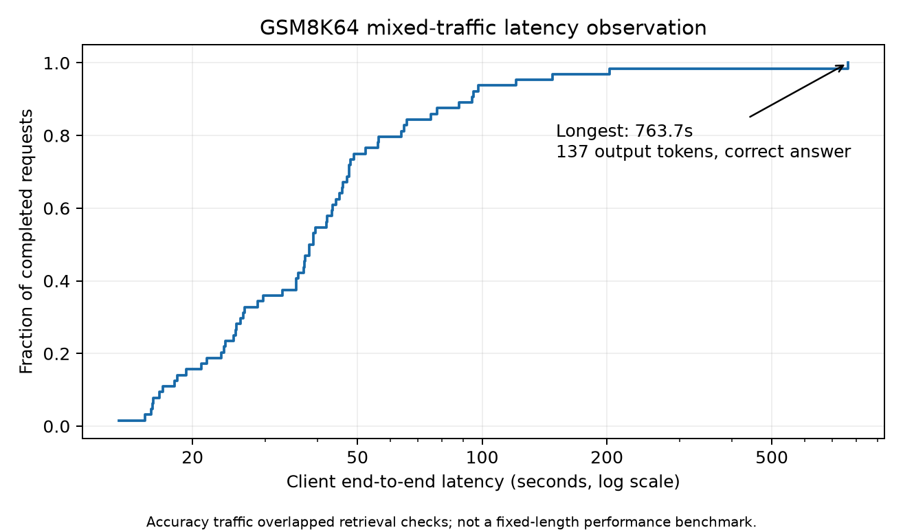
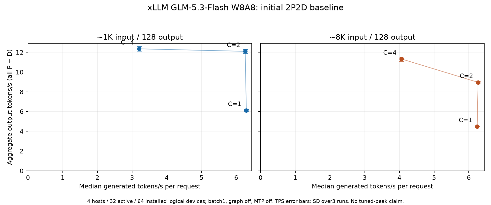
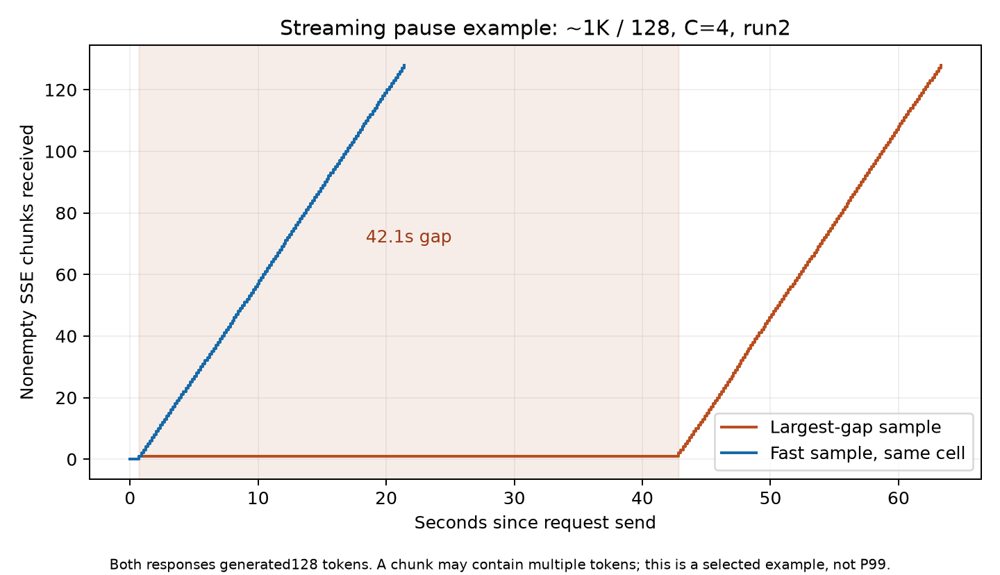

# GLM 5.3 Flash 的 xLLM 2P2D 部署与验证

2026-10-19。当前已完成 GLM-5.3-Flash W8A8 的四实例 2P2D 容器部署，12 项功能检查全部通过。初轮精度回归完成：GSM8K 抽样 63/64，已知答案状态检索 16/16。固定长度吞吐与延迟基线已完成，但自然停止补测发生 Decode NPU 异常，稳定性尚未验收；完整 1319 题与同题非 PD／高精度参考对照尚未运行。以下区分旧模型限制、当前运行路径与实际验证范围。

## 为什么此前不支持 PD，现在可以部署

| 对象与配置 | 已确认结论 | 原因 |
| --- | --- | --- |
| 早期 GLM-5.3 W8A8C8，`kv_cache_dtype=int8` | 当时检查的公开代码拒绝 C8 与 PD 组合；此限制没有删除 | packed C8 缓存布局及传输不能仅靠 PD 开关完成适配 |
| 当前 GLM-5.3-Flash W8A8，`backend=vlm` | 本次实机建链失败 | `VLMEngine` 调用不带传输的缓存分配；报 `KVCacheTransfer not initialized` |
| 当前 Flash W8A8，`backend=llm`、`model_impl=python`、`kv_cache_dtype=auto` | 已实测跑通文本 2P2D 功能链路 | `LLMEngine` 在 P/D 角色使用带传输的缓存分配；Python 模型可由文本工厂加载 |

模型从 GLM-5.3 C8 改成 Flash W8A8、缓存精度从 C8 改成随模型 dtype 的 auto、执行后端从 VLM 改为文本 LLM，是三个独立条件。当前结果不能作为“原 GLM-5.3 W8A8C8 已支持 PD”的证据，也不能推广为 Flash 视觉功能通过验证。此前把“不支持”泛化到所有 xLLM PD 路径的表述过宽，应按模型、缓存精度及后端限定。

固定源码为 `ad9e405650c1bbb0af53d2c8e821dbdcbe5e79eb`：

- [量化 KV 与 PD 的拒绝条件](https://github.com/xLLM-AI/xllm/blob/ad9e405650c1bbb0af53d2c8e821dbdcbe5e79eb/xllm/core/runtime/worker_impl.cpp#L548)。当前仍保留。
- [VLM 缓存分配](https://github.com/xLLM-AI/xllm/blob/ad9e405650c1bbb0af53d2c8e821dbdcbe5e79eb/xllm/core/distributed_runtime/vlm_engine.cpp#L285)。
- [LLM 按角色选择带传输分配](https://github.com/xLLM-AI/xllm/blob/ad9e405650c1bbb0af53d2c8e821dbdcbe5e79eb/xllm/core/distributed_runtime/llm_engine.cpp#L486)。
- [Python 文本模型工厂](https://github.com/xLLM-AI/xllm/blob/ad9e405650c1bbb0af53d2c8e821dbdcbe5e79eb/xllm/models/model_registry.cpp#L626)。

本次部署的上述三个缓存实现文件与离线固定源码的 SHA256 一致。构建补丁仅补充 TileLang AOT 主进程和子进程显式导入 `torch_npu`，没有删除 C8 PD 拒绝条件或修改模型 kernel 数学逻辑。

## 已运行配置

- 2 个 Prefill、2 个 Decode，每实例 TP8，使用每台设备编号 0–7，共 32 个活动逻辑设备。四台机器各有 16 个逻辑设备，首轮未使用全部设备。
- 文本 LLM 后端，Python 模型实现，PUSH 缓存传输；`reasoning_parser=glm5`。当前模板以 `<think>` 开始并默认使用 Reasoning Effort Max，不假定 `enable_thinking=false` 参数会关闭思考。
- Prefill chunk 8192，实例 `max_seqs_per_batch=1`，线性状态槽上限 16。
- 调度重叠、前缀缓存、图模式、MTP 关闭。这是功能基线，尚未调优到峰值性能。
- 镜像：`quay.io/jd_xllm/xllm-ai:xllm-dev-a3-arm-cann9-20260911`；manifest digest：`sha256:4fec4b05d8e698c830662f085445b77392d3b0e1d74f78be133f36628832100a`。
- [完整运行配置](flash-runtime-config.json)记录实际导入包版本：Triton 模块为 3.2.0，文件与 `triton_ascend==3.2.1` 的 RECORD 一致；基础镜像残留的 `triton==3.5.0` 元数据不能当作实际导入版本。测试中未更换包。
- xLLM-Service：`b232b7094f17fbab68f010290554b012ee384a0b`；xllm_ops：`b94b87318c2826738c65d6e6f242aa9c1881a3ab`。
- TP 内通信为 HCCL；P/D 传输日志显示 Mooncake 的 AscendDirectTransport/ADXL，`roce_mode=false`、`use_fabric_mem=false`。未把控制端口或未启用的 KV Store 的 `store_protocol=tcp` 当作实际 P/D 数据面协议。
- 上述镜像是基础开发镜像；xLLM、Service 与 native ops 在其中离线编译安装，并非原镜像开箱即用。当前 AOT 补丁只处理显式 NPU 后端初始化。
- 全部部署及测试在专用 Docker 容器内进行，K8s 未操作。

## 功能证据与精度范围

固定 2P2D 拓扑完成 12/12 功能检查，覆盖算术、固定文本、多轮记忆、长提示、SSE 流式和客户端并发 4。逐请求 ID 对应恰好一个 P 和一个 D，四台各处理 6 个请求。[功能证据](pd-functional-evidence.json)。

12 项功能测试不等于模型精度验收。此前非 PD 对照中保留了长提示推理重复、最终回答错误或输出预算耗尽的记录，尚未确认原因。

GSM8K 回归使用官方 main/test 的固定随机抽样 64 题，抽样种子 `20261019`；four-shot 固定为 train 前四题。采用权重附带的采样默认值 temperature=1.0、top_p=0.95，输出上限 2048，客户端并发 4。只提取最终 content 中 `####` 或 boxed 后的数值；reasoning 中的答案不计分。错误、截断和缺失回答均计入结果，不自动重试覆盖失败。请求超时预算为 1200 秒；没有传输错误不代表满足短时延服务目标。

这轮采用透明的标准库 HTTP 测试脚本，并非 EvalScope 输出。预先设定的初轮回归门槛为正确率至少 95%、无传输错误、无输出截断；这只用于决定是否进入首轮性能测量，不等于完整 1319 题或全面能力精度验收。另做 1K、8K、16K 长上下文已知答案检索与并发状态复用，要求全部通过。

## 初轮精度结果

| 检查 | 结果 | 范围 |
| --- | --- | --- |
| GSM8K 固定抽样 | 63/64，98.44%；0 传输错误，0 截断 | main/test 中 64/1319 题，four-shot |
| 已知答案状态检索 | 16/16 | 约 1K、8K、16K 输入，前四条顺序提交、12 条并发提交 |

[评分汇总](gsm8k-summary.json)、[抽样与请求配置](gsm8k-manifest.json)、[逐题预测](gsm8k-predictions.jsonl)、[状态回归](state-regression-summary.json)保留原始结果。GSM8K 的 95% Wilson 区间约为 91.67%–99.72%，抽样分数不能证明总体无精度损失。错误题为 index=962：模型输出机票费用 600，参考答案包含物资与机票合计 1000，按原评分规则计错。

测试同时观察到异常长等待：一条只生成 137 token 的正确数学回答耗时 763.69 秒，一条约 1K 的正确检索耗时 637.42 秒。两组精度流量有重叠，等待原因尚未确认；这些数值作为排队风险保留，不冒充固定负载性能结果。



## 性能测试口径

精度两项门槛通过后，已完成 1K/128、8K/128 输入输出负载、并发 1/2/4、每档三次重复的初轮扫描。各单元独立预热，按服务返回的 usage 计算真实输入和输出 token，记录请求延迟、TTFT、TPOT、首个可见答案时间及流式 chunk 间隔。固定输出压测开启 ignore_eos，不用 max_tokens 代替实际计数。128-token 固定输出可能在思考过程结束前截断，因此这里只测生成性能；首个可见最终答案时间单列，不能把 reasoning 的首 token 当成完整回答延迟。

计时统一使用一台客户端的单调时钟；服务器墙钟有偏差，未修改主机时间。吞吐报告整套 2P2D 结果，同时列出按四台整机、32 个活动逻辑设备、四台共 64 个已安装逻辑设备归一化的值，不只除以 Decode 设备。少量请求不用于宣称稳定 P99 或最优吞吐。


## 固定长度性能结果

18/18 个测量单元完成，144/144 测量请求成功，42 个预热请求成功。每个输入/并发组合三次重复、每次八个测量请求。真实输入分别为 1042、8189 token，输出均为 128 token。表中吞吐是三次运行均值±样本标准差，延迟分位数汇总每组 24 个请求；均包含排队。

| 输入/输出 | 并发 | 整套输出 token/s | TTFT P50/P95（秒） | TPOT P50（毫秒） | 请求延迟 P50/P95（秒） |
| --- | --- | --- | --- | --- | --- |
| 1042/128 | 1 | 6.12 ± 0.08 | 0.71/0.74 | 158.9 | 20.88/21.54 |
| 1042/128 | 2 | 12.10 ± 0.20 | 0.71/0.72 | 159.8 | 21.00/21.81 |
| 1042/128 | 4 | 12.35 ± 0.23 | 0.71/1.41 | 312.3 | 40.42/42.58 |
| 8189/128 | 1 | 4.48 ± 0.00 | 8.21/8.34 | 160.2 | 28.62/29.24 |
| 8189/128 | 2 | 8.96 ± 0.07 | 8.18/8.30 | 159.6 | 28.49/29.11 |
| 8189/128 | 4 | 11.32 ± 0.22 | 8.21/16.40 | 246.1 | 40.20/48.90 |

这是 batch=1、graph/MTP 关闭、仅使用四台的一半逻辑设备的保守配置结果，不能作为 xLLM 峰值性能。单请求短输入生成速度中位数约 6.29 token/s；并发从 2 增至 4 时，1K 负载吞吐几乎不再提升，而请求延迟接近翻倍，提示需要进一步剖析 Decode 排队和批处理。该判断是待验证方向，尚未完成 profiler 因果定位。

所有固定 128-token 响应均仍处于 reasoning 阶段，没有最终 content。因此 TTFT 包含思考首 token；本表不提供完整答案时延。输出吞吐与输入+输出总吞吐不同，[CSV](performance-summary.csv)分别记录，两者不能混用。



逐请求关联日志确认每条测量请求对应一个 P 和一个 D，两个 P、两个 D 各处理 72 条测量请求，证明测量时确为完整 2P2D。[路由证据](performance-routing-evidence.json)、[原始测量包](performance-raw.tar.gz)、[测量配置](performance-manifest.json)、[统计 JSON](performance-summary.json)。

## 稳定性风险与自然停止补测

固定长度基线虽然全部成功，仍观察到 42.10 秒的最大流式 chunk 间隙：该请求 TTFT 仅 0.715 秒，但首个 delta 后长时间没有后续输出，总耗时 63.29 秒。TTFT 无法单独代表交互流畅度。图为选定异常样本，chunk 数不等于 token 数，也不是 P99。



为测量真正可见答案的延迟，另准备 first-8 GSM8K、four-shot、自然停止、C2、2048-token 上限的补充测试，且与固定长度压测分开运行。第一轮预热一条成功（77 输出 token，12.41 秒，首个非空白 content 5.01 秒），另一条响应提前结束，没有完整 DONE/usage；尚未进入八条正式测量，不能据此计算成功样本吞吐或完整答案分位数。失败发生时一个 Decode 实例出现 NPU vector/MTE 地址越界（507035）并退出，路由随后摘除该实例。

异常在 `gather_index_history` 的主机同步处被报告；NPU 异步执行使该栈不能证明它就是实际出错 kernel。日志同时含 HCCL AllReduce/SDMA 报错，可能为故障传播，不能直接认定网络或硬件损坏。未通过屏蔽错误、删除边界检查来宣称修复。仅重启故障 Decode 后再次出现同类设备异常，复测在进入正式八题前终止；[恢复后记录](natural-recovery-raw.tar.gz)与[日志](natural-recovery-crash-log.txt)均保留。第一轮失败数据保留于[原始包](natural-attempt1-raw.tar.gz)，[异常日志摘录](natural-crash-log.txt)保留设备异常与路由摘除证据。

随后干净重启全部四个模型实例，四个模型 API 就绪后重测：预热题 0 正确完成（167 输出 token，29.85 秒），题 1 在 41.78 秒响应中断，未返回 DONE/usage；.11 Decode 再次发生同类 507035 异常。八条正式测量仍未开始。原先“仅为长时间运行后偶发”的解释不足，仍需定位实际算子、缓存边界及传输交互。[冷启动原始记录](natural-cold-raw.tar.gz)、[异常日志](natural-cold-crash-log.txt)、[各次状态](natural-stop-status.json)。只读抽查该机 card0/chip0 的 npu-smi health 为 OK，不能据此排除全部硬件或驱动问题。

当前结论：**文本 2P2D 的功能链路及初轮抽样精度通过，固定长度性能基线完成；长时间运行和自然停止稳定性尚未验收。** 完整 GSM8K 1319 题、同题非 PD/高精度参考、稳定性与故障根因仍需补充。

## 复现实验

部署版本与 flags 见[运行配置](flash-runtime-config.json)及启动脚本。服务器离线，GSM8K test 与 train 前四题需预先放在 `/work/`；先运行 `evaluate_gsm8k.py`、`evaluate_state_reuse.py`，通过各自 summary 门槛后运行 `benchmark_pd.py`。每次使用新结果目录，保留失败，不以重试覆盖。自然停止补测使用 `benchmark_natural.py` 单独运行；若实例已故障或不足 2P2D，停止测量并先恢复，不将降级流量并入完整拓扑结果。

下载原始性能包后，在目录外解压并统计：

```bash
python3 -m pip install -r plot-requirements.txt
tar -xzf performance-raw.tar.gz
python3 summarize_performance.py --input perf-2p2d-20261019 --output .
```

[K8s 保留核对](k8s-preservation-summary.json)：四台 K8s 容器 ID 与测试前一致，数量分别为 17/17/17/11；仅做只读容器 ID 对照。本次所有停止、启动、编译和测试操作均限于本项目 Docker 容器，未操作 K8s。
